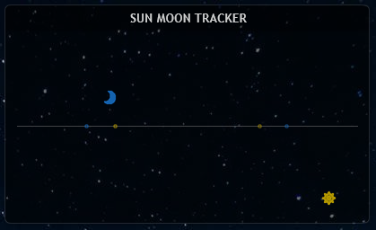

# Astronomy Suite

> 把我自己折腾的日月升降数据，变成 Rainmeter 里能看的四个小视图：**地球光照球、每日轨迹、天空位置模拟、事件时间轴**。
> 
> 写这份 README 主要有两个目的：
> - **你想直接用**：照着“快速部署”走一遍，就能在桌面上看到效果。
> - **你想移植到别的平台**：我把四个视图分别在看什么、数据怎么流、核心公式是什么、我当时踩过哪些坑，都尽量讲清楚，方便你搬到 Web、App 或者别的桌面工具里。
> 
> 先交个底：我不是专业程序员。这个项目就是我边查资料、边试错、边改代码攒出来的。里面有不少“当时够用就行”的妥协，我都写在后面了。大佬轻喷，能跑、能看、能让我自己觉得好玩，是我最大的目标。

---

## 效果预览

<table align="center">
  <tr>
    <td align="center"><br><sub><b>2026-10-27_21-50</b></sub></td>
    <td align="center"><br><sub><b>2026-10-30_11-23</b></sub></td>
    <td align="center"><br><sub><b>2026-10-27_21-50</b></sub></td>
  </tr>
  <tr>
    <td align="center" colspan="3"><sub><b>地球光照球</b> — 太阳和月亮双模式，用 360 张图平滑插值出真实的太阳直射经度图片</sub></td>
  </tr>
  <tr>
    <td align="center"><br><sub><b>2026-10-28_09-00</b></sub></td>
    <td align="center"><br><sub><b>2026-10-30_22-35</b></sub></td>
    <td align="center"><br><sub><b>2026-10-28_09-00</b></sub></td>
  </tr>
  <tr>
    <td align="center" colspan="3"><sub><b>位置模拟</b> — 看看天体在天空中在哪个位置</sub></td>
  </tr>
</table>

> 想看更多截图？去 `EffectPreviewImage_*/` 文件夹里溜达一圈吧。

---

## 仓库结构

下载完代码，你可能一脸懵。别急，这里是各个文件夹的“说明书”：

```text
.
├── AstronomicalEvents.xml          # Windows 的任务计划配置文件
├── GlobePicture.zip                # 360张地球图片打包（嫌仓库大可以直接单下这个）
├── Background/                     # 皮肤的背景图
├── icon/                           # 太阳、月亮和那个小标记的图标
├── EffectPreviewImage_*/           # 截图都在这儿
├── Event Time Case/                # 懒人福音：现成的示例数据（4个 txt）
├── GlobePicture/                   # 360张地球自旋图片 (globe_000 ~ 359)
├── Script_Globe/                   # 地球光照球用的 Lua 脚本
├── Script_SunMoonTracker/          # 轨迹视图用的 Lua 脚本
├── Skins_Globe/                    # 地球光照球的皮肤配置 (.ini)
├── Skins_SunMoonTracker/           # 轨迹视图的皮肤配置 (.ini)
└── Users Public Documents/         # 数据采集端（抓数据的 PS1 脚本和 API 配置）
```

---

## 这个项目到底在干嘛？

先别急着看代码，咱们把整条链路捋一遍。这个项目其实分成 **“采数据”** 和 **“画皮肤”** 两段：

```text
Windows 任务计划（AstronomicalEvents.xml）
        │  每 4 小时触发一次，开机后也会补跑
        ▼
PowerShell 采集脚本（AstronomicalEvents.ps1）
        │  读 WeatherApiKeys.json
        │  查公网 IP → 百度定位 → 和风天气城市编码
        │  拉日月升降数据
        ▼
4 个文本文件（放在 C:\Users\Public\Documents\Rainmeter Data\）
        │
        ├─ SunEvents.txt / MoonEvents.txt
        │     给人看的本地时间格式：yyyyMMddHHmm + 事件名
        │
        └─ SunTimeStampEvent.txt / MoonTimeStampEvent.txt
             给 Lua 算的 Unix 时间戳格式：10 位时间戳 + 事件名
        │
        ▼
Rainmeter 皮肤（Lua + INI）
        │  Lua 读 TimeStamp 文件，算比例、算坐标、算图片索引
        │  INI 把 Lua 返回的数字变成图片和文字
        ▼
你屏幕上看到的地球球、轨迹、事件条、位置模拟
```
一句话总结：**PS1 负责把网上的日月升降时间抓下来，Lua 负责把这些时间翻译成“现在该显示第几张图 / 天体在哪个坐标”，INI 负责把图和字摆到屏幕上。**

---

## 四个视图分别在干嘛？

这是移植时最需要先理解的部分。四个视图吃的是同一批数据，但各自关心的事情不一样。

### 1. 地球光照球（Globe 系列）

**它回答的问题**：现在地球被照亮的半球转到哪一面了？

- **输入**：`SunTimeStampEvent.txt` 或 `MoonTimeStampEvent.txt`。
- **输出**：一张 `globe_000.png` 到 `globe_359.png` 里的图片索引。
- **核心**：用当前时间在“升起 → 落下 → 次日升起”周期里的比例 `t`，在日出图片索引和日落图片索引之间做插值。
- **注意**：月亮球用的是同一套地球纹理和插值公式，显示的是“月亮可见期的视觉进度”，**不是真实的月亮直射经纬度**，只是借同一套公式让视觉同步转起来。

### 2. 每日轨迹（Trajectory Viewer）

**它回答的问题**：今天太阳和月亮一天里是怎么走的？

- **输出**：太阳/月亮在屏幕上的 `(X, Y)`，以及今天日出、日落、月出、月落的标记位置。
- **X 轴**：把今天 0:00 到 24:00 铺满时间轴，当前时间决定 X。
- **Y 轴**：用当前前后事件的抛物线模型，白天开口向下，夜晚开口向上。
- **注意**：事件标记只标**今天**的事件；今天没有的事件（比如月亮那天没升起来），标记会落到容器外，视觉上不显示。

### 3. 天空位置模拟（Position Simulator）

**它回答的问题**：在一个完整的升降周期里，太阳/月亮现在大概在天空的什么位置？

- **输出**：太阳/月亮的 `(X, Y)`，以及本周期升起、落下的标记。
- **核心**：它不按日历日，也不按滚动窗口，而是先找当前的一个“四事件周期”（`Set → Rise → Set → Rise`）。
- **X 轴**：当前时间在这个周期里的比例，映射到整条时间轴。
- **Y 轴**：和每日轨迹一样的抛物线模型。

### 4. 事件时间轴（Event Tracker）

**它回答的问题**：接下来几个升降事件大概什么时候发生？

- **输出**：太阳/月亮固定在时间轴偏左的位置，事件标记按时间在时间轴上滚动。
- **时间窗口**：以当前时间为中心，往前一段、往后一段（默认总共 48 小时）。
- **注意**：事件标记最多 5 个（当前时间之前最近 1 个，之后最近 4 个）；超出窗口的事件会落到容器外，被裁掉。

---

## 快速部署（Rainmeter）

### 第一步：建个皮肤文件夹
1. 在电脑右下角找到 Rainmeter 的小雨滴图标，右键它，选 **“皮肤” → “打开皮肤目录”**。
2. 在弹出的 `Skins` 文件夹里，新建一个名叫 **`Astronomy Suite`** 的文件夹，这就是咱们的主阵地了。

### 第二步：把文件对号入座
从仓库下载文件后，按下面的结构老老实实摆放。
*(小提示：`@Resources` 是个神奇的共享文件夹，所有的 `.ini` 皮肤都是去这里找图片和脚本的。)*

```text
Rainmeter/Skins/Astronomy Suite/
│
├── @Resources/                     # 共享资源都放这
│   ├── globe/                      # 把 GlobePicture.zip 解压到这里
│   │   ├── globe_000.png
│   │   └── ... (一直到 globe_359.png)
│   │
│   ├── Background_double.png       # 从 Background/ 里拿
│   ├── Tracker_*.png               # 从 icon/ 里拿
│   │
│   ├── Globe.lua                   # 来自 Script_Globe/
│   ├── Globe_Combine.lua           
│   ├── Event Tracker.lua           # 来自 Script_SunMoonTracker/
│   ├── Position Simulator.lua      
│   └── Trajectory Viewer.lua       
│
├── Globe/                          # 地球光照球皮肤
│   ├── BodyType.inc
│   ├── Globe.ini
│   ├── Globe_Combine.ini
│   ├── Globe_Moon.ini
│   └── Globe_Sun.ini
│
└── SunMoonTracker/                 # 轨迹与事件皮肤
    ├── Event Tracker.ini
    ├── Position Simulator.ini
    └── Trajectory Viewer.ini
```

### 第三步：搞点天文数据来
皮肤其实就是个“空壳”，它得去 `C:\Users\Public\Documents\Rainmeter Data\` 读数据。你有两条路可以选：

**路子 A：只想看看效果（极速版）**
直接从仓库的 `Event Time Case` 文件夹里，把那 4 个 `.txt` 文件掏出来，扔进上面的目录里。
> *偷偷告诉你：这个文件夹里的数据是 GitHub Actions 每天自动更新的，不过默认用的是北京的经度哦。*

**路子 B：我想自己长期用，看自己城市的（折腾版）**
1. 把 `Users Public Documents` 里的 `AstronomicalEvents.ps1` 和 `WeatherApiKeys.json` 挪到 `C:\Users\Public\Documents\`。注意：这俩要放一起，脚本会在它自己所在目录找配置文件。
2. 去这两个地方白嫖一下免费的 API 密钥：[和风天气](https://id.qweather.com/#/login) 和 [百度地图](https://lbsyun.baidu.com/apiconsole/becomedev/selection)。
3. 把密钥填进 `WeatherApiKeys.json` 里保存好。
4. 右键那个 `.ps1` 文件，选“使用 PowerShell 运行”，看它能不能吐出数据。如果没问题，双击 `AstronomicalEvents.xml` 导进系统的任务计划，以后每 4 小时它就会自己帮你抓数据啦。
   *(小提示：这里用 SYSTEM 账户运行，主要是为了保证不管电脑当前是谁登录（或者没登录），任务都能顺利启动起来，准时去拿数据。)*

### 第四步：开玩！
刷新一下 Rainmeter，点开 `Astronomy Suite`，挑个顺眼的加载吧：
- `Globe\Globe_Combine.ini`（想看日月双球的选这个）
- `SunMoonTracker\Trajectory Viewer.ini`（想看运动轨迹的选这个）

---

## 核心原理与算法模型

这玩意儿到底是怎么转起来的？其实它靠的是一个大杀器：**时间比例 `t`**，然后兵分两路去画图。

### 基础：算出一个时间比例 `t`

不管你想画什么，系统首先得知道“现在”是在哪两个事件（升起和落下）中间的。找到前后的 `prevEvent` 和 `nextEvent` 后，掏出这个公式：

```text
ratio = (now - prevEvent.time) / (nextEvent.time - prevEvent.time)

if (prevEvent 是升起 AND nextEvent 是落下):  
    t = ratio        // 可见期，t ∈ [0, 1]
else:              
    t = 1 + ratio    // 隐藏期，t ∈ [1, 2]
```
> **通俗点说**：`t` 就是个进度条。如果在白天（可见期），`t` 从 0 跑到 1，代表从升到落；如果在夜里（隐藏期），`t` 就从 1 跑到 2，代表从落到升。

---

拿到这个进度条 `t` 之后，两个不同的皮肤系列就各奔东西了：

#### 分支一：Globe 系列（地球光照球）
这哥们比较单纯，它只要图片序号。它就拿着 `t` 去日出和日落的图片序号中间找位置，插值出一个 `0~359` 的编号，直接往屏幕上贴。
- 白天（`t ≤ 1`）就在日出和日落的图里找。
- 夜里（`t > 1`）就在日落和第二天日出的图里找。
> **晨昏线的作用是啥？** 在这里，晨昏线就像一个分拣员。把它对应的那两张图剔掉之后，剩下的索引区间，就能明明白白地告诉你：这堆图代表白天，那堆图代表夜晚。
*(想知道具体的数学魔法，去翻翻 `Globe.lua`)*

#### 分支二：SunMoonTracker 系列（轨迹/事件视图）
这就复杂点了，它得算出天体在屏幕上的 `(X, Y)` 坐标。**有意思的是，Y 轴高度靠 `t` 算，但 X 轴位置得看绝对时间。**

**1. Y 轴：扔个抛物线（靠 t 算）**
根据 `t` 的值，决定是用向上开口的抛物线还是向下开口的抛物线：
```text
可见期（t ∈ [0,1]）:  y = HorizonY - (HorizonY - apex)  * (1 - (2t - 1)²)
隐藏期（t ∈ [1,2]）:  y = HorizonY + (nadir - HorizonY) * (1 - (2(t-1) - 1)²)
```
*(你会发现，当 t=0 或 1 时，y 刚好就在地平线上；t=0.5 或 1.5 时，它正好挂在最高/最低点)*

**2. X 轴：各走各的阳关道（绝对时间算）**
X 轴才不理会 `t` 呢，每个视图都有自己的小算盘：
| 视图 | X 轴是怎么算的？ |
|---|---|
| **Trajectory Viewer** | `x = xStart + (now - todayStart) / secondPerPixel` (简单粗暴，把一天 24 小时硬塞进屏幕宽度里) |
| **Event Tracker** | 天体死盯屏幕左边不动，事件标记按 `(eventTime - axisStart) / secondPerPixel` 往后滚 |
| **Position Simulator** | 这哥们特别，它用“四个事件”作为一个周期来算比例 |

> **啥是四事件周期？** 在 `Position Simulator` 里，为了让轨迹看起来很顺滑，它不仅看前后的两个事件，而是把 `[Set₁, Rise₁, Set₂, Rise₂]` 这四个事件全拉过来。拿中间两个当起止点，算算现在时间在这个长周期里到底走了百分之几。

---

## 移植建议与进阶指南

如果你是个开发者，觉得这套逻辑挺好玩，想把它搬到 Web、手机 App 或者别的桌面上，下面这几条老司机的建议，你可以看看：

### 1. 关于 API 和密钥
- **找谁要数据？** 讲真，我找了一圈，目前能提供月升月落数据的 API 渠道真的太少了，和风天气算是里面最合适的一个。
- **怎么防扣费？** 如果你是做给别人用的 App，千万别把开发者的 Key 塞在代码里。建议你**一次性把数据拉多点**（比如拉取一周的），让用户自己刷新得少点。请求少了，自然就不会达到扣费的门槛了。另外，给用户留个设置接口，让他们填自己的 Key。

### 2. 渲染：从 2D 降维到 3D 升维
- **现在的土办法（降维）**：我们现在的 360 张图，其实默认了一个前提——太阳直射点在赤道上，没去模拟它在南北回归线之间来回跑，所以你不会看到真实的光照区域。
- **高级玩法（升维）**：换到 Web 或 App 上，直接用 Three.js 或者原生的 3D 引擎，搞一张地球皮贴上去，用 Shader 结合太阳直射的经纬度算一算，不管什么季节、什么纬度，晨昏线都给你算得明明白白的。

### 3. 画曲线，别死磕抛物线
- **为啥要用抛物线？** 你可能以为 Rainmeter 画不出曲线，其实它能画。之所以咱们现在用 `1 - (2t-1)²` 这个抛物线，是因为在画的时候，数据这块我做不出来，没法很好地去呈现这个曲线。所以最后只保留了这个算法，没画出那条完美的曲线。
- **换个好用的工具**：你要是用 Web，拿个 SVG、Canvas，或者直接画贝塞尔曲线、正弦函数，画出来的天体轨迹绝对比现在顺滑得多。

### 4. 别被月亮“坑”了（异常处理）
- **月亮偶尔会旷工**：月亮的公转周期比 24 小时长了那么一点点（大概 24小时50分钟）。所以总有那么几天，它一天只能升上来或者落下去一次。
- **我们在后台把它擦了屁股**：为了让前端不崩溃，我们在 PS1 脚本生成数据时，就把空的数据打个 `nullMoonset` 的标记，然后用**时间排序**把这种垃圾数据踢到最后一行，直接切掉。这样交给 Lua 的数据，绝对是干干净净、成双成对的“一升一落”。
- **前端留个心眼就行**：既然后端数据是干净的，前端就不用费劲去写复杂的容错代码了。稍微做一个简单的 `tonumber` 判断，防止别人手动改坏了文件就行。
