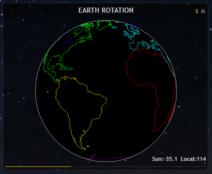
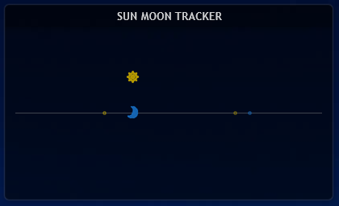
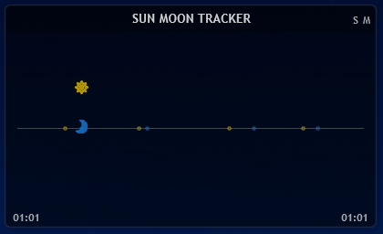
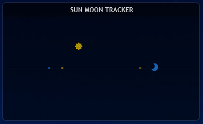

# Astronomy Suite

> 把日月升降时间变成四种可视化视图：**地球光照球、天体轨迹、事件时间轴、视位置模拟**。
> 核心不依赖 Rainmeter。本质是：**事件时间序列 + 本地经度 → 几何公式 → 图像**。

---

## 效果预览

<table>
<tr>
<td width="50%"><br><sub><b>地球光照球</b> — 太阳/月亮双模式，360 张序列插值还原晨昏线</sub></td>
<tr>
<tr>
<td width="50%"><br><sub><b>天体轨迹</b> — 24 小时连续抛物线运动，含升落标记</sub></td>
</tr>
<tr>
<td><br><sub><b>事件追踪</b> — 以当前时间为中心滚动展示未来 5 个事件</sub></td>
<tr>
<tr>
<td><br><sub><b>位置模拟</b> — 四事件周期内的天体视位置</sub></td>
</tr>
</table>

> 更多的截图保存在 `EffectPreviewImage_*/` 文件夹中。

---

## 仓库结构

```text
.
├── AstronomicalEvents.xml          # Windows 任务计划配置文件
├── GlobePicture.zip                # 360张地球图片的压缩包（方便单独下载，仓库内已有解压版）
├── Background/                     # 皮肤背景图
├── icon/                           # 太阳、月亮及标记图标
├── EffectPreviewImage_*/           # 效果预览图
├── Event Time Case/                # 现成的示例数据（4个 txt 文件）
├── GlobePicture/                   # 360张地球自旋图片序列 (globe_000 ~ 359)
├── Script_Globe/                   # Globe 系列皮肤的 Lua 脚本
├── Script_SunMoonTracker/          # Tracker 系列皮肤的 Lua 脚本
├── Skins_Globe/                    # Globe 系列皮肤 (.ini)
├── Skins_SunMoonTracker/           # Tracker 系列皮肤 (.ini)
└── Users Public Documents/         # 数据采集端（PS1 脚本与 API 配置）
```

---

## 快速部署（Rainmeter）

**前置**：Windows 10/11、Rainmeter 4.5+

### 第一步：准备数据（二选一）
- **方案 A（只想看效果）**：将 `Event Time Case` 文件夹内的 4 个 txt 文件，直接复制到 `C:\Users\Public\Documents\Rainmeter Data\` 目录下（没有该目录请手动新建）。
- **方案 B（长期使用）**：将 `Users Public Documents` 里的 `AstronomicalEvents.ps1` 和 `WeatherApiKeys.json` 复制到 `C:\Users\Public\Documents\` 下，填入 API 密钥，然后运行一次。之后双击 `AstronomicalEvents.xml` 导入任务计划实现每 4 小时自动刷新。

### 第二步：部署 Rainmeter 皮肤
1. 将本仓库下载（或克隆）到 Rainmeter 皮肤目录：
   ```powershell
   cd "$env:USERPROFILE\Documents\Rainmeter\Skins"
   git clone https://github.com/<yourname>/rainmeter-sun-moon-tracker.git
   ```
2. 确保 `GlobePicture` 文件夹内包含 360 张图片。（如果你单独下载了 `GlobePicture.zip`，请将其解压并改名为 `GlobePicture`）。
3. 刷新 Rainmeter，在管理器中加载任意皮肤：
   - `Skins_Globe\Globe_Combine.ini` （日月双球）
   - `Skins_SunMoonTracker\Trajectory Viewer.ini` （轨迹视图）

---

## 核心原理（平台无关）

### 输入
- **事件时间序列**：`(time, type)` 列表，type ∈ `Sunrise/Sunset/Moonrise/Moonset`，按时间升序。
- **本地经度** `lon`：东经正、西经负，仅地球光照球视图需要。

### 四个公式

**1. 时间比例 t**
```text
ratio = (now - prev.time) / (next.time - prev.time)
if prev是升起 and next是落下:  t = ratio        // 可见期 [0,1]
else:                          t = 1 + ratio    // 隐藏期 [1,2]
```

**2. 抛物线 Y 坐标**
```text
可见期: y = HorizonY - (HorizonY - apex)  * (1 - (2t - 1)²)
隐藏期: y = HorizonY + (nadir - HorizonY) * (1 - (2(t-1) - 1)²)
```
`t=0.5` 达顶点/底点，`t=0/1` 时 `y=HorizonY`。太阳 `apex` 随白昼时长动态调整，月亮固定。

**3. 地球图片索引**
```text
riseIdx = ((-lon - 90) % 360 + 360) % 360
setIdx  = (( 90 - lon) % 360 + 360) % 360

t ≤ 1:  idx = lerp360(riseIdx, setIdx, t)
t > 1:  idx = lerp360(setIdx, riseIdx, t - 1)
最终:   round(idx) % 360

// lerp360 处理循环边界
lerp360(a, b, r) = a <= b ? a + (b - a) * r : a + (b + 360 - a) * r
```
验证（`lon=114`）：`riseIdx=156, setIdx=336`，正午 `t=0.5 → idx=246`，直射经度 `-246 mod 360 = 114`，自洽。

**4. X 轴（三选一）**
| 视图 | X 轴 |
|---|---|
| 天体轨迹 | `x = xStart + (now - todayStart) / secondPerPixel` |
| 事件追踪 | 天体 X 固定，事件按 `(eventTime - axisStart) / secondPerPixel` 映射 |
| 位置模拟 | `x = xStart + (now - cycle.start) / (cycle.end - cycle.start) * length` |

**四事件周期**：取 `[Set₁, Rise₁, Set₂, Rise₂]`，前两个中点作起点，后两个中点作终点。太阳和月亮各用各的周期，因此 X 进度不同步。

### 输出
图片索引（0~359）、天体坐标 `(x, y)`、事件坐标数组、状态字符串、`HH:MM` 时间文字。

---

## 移植参考

### 需要准备
| 项目 | 用途 |
|---|---|
| 事件时间序列 | 一切计算的基础 |
| 本地经度 | 地球光照球视图 |
| 360 张地球图 | 地球光照球视图 |
| 容器尺寸 | 抛物线/布局计算 |
| 时间轴参数 | 轨迹/事件/位置视图 |

### 必须保留的数学不变量
- **t 的分段**：`[0,1]` 可见期，`[1,2]` 隐藏期，共用同一 `ratio`
- **抛物线形状**：`1 - (2t-1)²` 决定了天体在顶点减速、地平线加速的视觉感
- **索引锚点**：`riseIdx = -lon-90`，`setIdx = 90-lon`
- **循环插值**：`start > finish` 时给 `finish` 加 360
- **周期边界**：用四事件中点作边界，避免瞬间坐标跳变

### 可以自由替换
| 部分 | 可选方案 |
|---|---|
| 数据来源 | 本地天文库 (`suncalc`/`astral`) / 公共 API / 系统 API |
| 事件文件格式 | JSON / CSV / 内存对象 / 数据库 |
| 图片序列 | 360 张真实图 / 24 张整点图+插值 / Canvas 实时绘制 |
| 视图组合 | 四种任选其一或组合 |
| 刷新频率 | 秒级 / 分钟级 / 事件触发 |

### 移植注意事项

**数据**
- **时区一致性**：原版时间戳基于生成机器本地时区转 UTC，跨时区需显式转换。
- **事件交替性**：算法假设升起/落下交替，异常数据需容错。
- **null 事件**：`nullMoonrise` 表示无事件，解析时忽略。
- **数据密度**：位置模拟需前后各 2 个同类事件，至少 3 天窗口。
- **时间戳位数**：2038 年后变成 11 位，建议用正则 `^(%d+)(%a+)$` 匹配，而非定长截取。

**算法**
- 地平线、`apex`、`nadir` 随容器高度联动，不能只改一个。
- 顶点/底点留出 `iconSize/2 + offset` 余量，避免图标贴边被裁。
- `t=0/1` 时天体压地平线，可加微小 epsilon 避免视觉“卡住”。
- 月亮顶点固定，若追求精度可引入赤纬/月相，但不能破坏 t 的分段。

**显示**
- 索引取整在 `359↔0` 可能抖动，可加方向判断或平滑。
- 平台刷新频率受限（如 Android Widget 15分钟）时，事件追踪比连续动画更合适。
- 事件标签在窄容器易重叠，需动态布局或滚动。

**平台**
- 经度决定“晨昏线在哪”，时区决定“当前时间”，两者需分开传参。
- 移动端注意电池和后台保活；沙盒应用注意数据目录不可写问题。

---

## 数据格式

**格式 A（人读）**：`yyyyMMddHHmmEventType` （如 `202610221736Sunset`）
**格式 B（计算）**：`Unix秒EventType` （如 `1792661760Sunset`）

**要求**：按时间升序、升起落下交替、至少覆盖 3 天。缺失事件写 `nullMoonrise`，移植时忽略 `null` 前缀行。

---

## 配置速查（Rainmeter）

**采集端**
- `AstronomicalEvents.xml` 中 `<Interval>PT4H</Interval>` 可改为 `PT6H` / `PT12H` 减少调用。

**展示端关键参数**
| 参数 | 默认值 | 说明 |
|---|---|---|
| `LocalLongitude` | `114` | 本地经度 |
| `SecondPerPixel`（Trajectory） | `240` | 360×240 = 86400s = 24h |
| `SecondPerPixel`（Event） | `480` | 360×480 ≈ 2 天 |
| `TimeOffsetInPixels` | `60` | 当前时间距轴起点像素 |
| `OffsetValue` | `15` | 抛物线顶点浮动幅度 |
| `IconSize` | `21` | 图标尺寸 |
| `UpdateDivider` | `60` | Lua 计算间隔（秒） |

**切换太阳/月亮**：`Globe.ini` 点击 `S`/`M`，状态存 `BodyType.inc`；或手动改 `BodyType=Sun` → `Moon`。

---

## 常见问题

- **txt 没生成？** 检查 `WeatherApiKeys.json` 是否在 PS1 同目录、字段名是否正确；手动跑看控制台报错。
- **地球空白/图片错乱？** 确认 `GlobePicture` 文件夹内包含 `globe_000.png ~ 359.png` 共 360 张图。
- **光照位置不对？** `LocalLongitude` 与数据城市经度不一致，改成实际值。
- **轨迹/事件不在容器内？** 减小 `OffsetValue`、`SecondPerPixel`，或增大 `SkinHeight`。
- **任务计划跑了但没数据？** 查历史记录返回码；SYSTEM 账户桌面路径不可写时，改错误日志到公共目录。

---

## 已知限制

- `LocalLongitude` 不自动同步，需手动保持一致。
- Lua 解析用 `line:sub(1, 10)`，2038 年后失效。
- 月亮顶点固定，未考虑月相/赤纬。
- 事件不足时位置模拟会退化。
