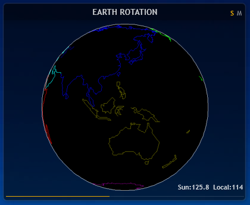

# Astronomy Suite

> 把无聊的日月升降时间，变成眼前四种超酷的可视化视图：**地球光照球、天体轨迹、事件时间轴、视位置模拟**。
> <br>`（注：这篇 README 里，我主要放了地球光照球和视位置模拟这两种效果图给大家瞧瞧。）`

---

## 效果预览

<table align="center">
  <tr>
    <td align="center"><br><sub><b>2026-10-27_21-50</b></sub></td>
    <td align="center"><br><sub><b>2026-10-30_11-23</b></sub></td>
    <td align="center"><br><sub><b>2026-10-27_21-50</b></sub></td>
  </tr>
  <tr>
    <td align="center" colspan="3"><sub><b>地球光照球</b> — 太阳和月亮双模式，用 360 张图平滑插值出真实的晨昏线</sub></td>
  </tr>
  <tr>
    <td align="center"><br><sub><b>2026-10-28_09-00</b></sub></td>
    <td align="center"><br><sub><b>2026-10-28_09-00</b></sub></td>
    <td align="center"><br><sub><b>2026-10-28_09-00</b></sub></td>
  </tr>
  <tr>
    <td align="center" colspan="3"><sub><b>位置模拟</b> — 看看天体在四个事件周期里到底在哪个位置</sub></td>
  </tr>
</table>

> 想看更多截图？去 `EffectPreviewImage_*/` 文件夹里溜达一圈吧。

---

## 仓库结构

下载完代码，你可能一脸懵。别急，这里是各个文件夹的“说明书”：

```text
.
├── AstronomicalEvents.xml          # Windows 的任务计划配置文件
├── GlobePicture.zip                # 360张地球图片打包（嫌仓库大可以直接单下这个）
├── Background/                     # 皮肤的背景图
├── icon/                           # 太阳、月亮和那个小标记的图标
├── EffectPreviewImage_*/           # 截图都在这儿
├── Event Time Case/                # 懒人福音：现成的示例数据（4个 txt）
├── GlobePicture/                   # 360张地球自旋图片 (globe_000 ~ 359)
├── Script_Globe/                   # 地球光照球用的 Lua 脚本
├── Script_SunMoonTracker/          # 轨迹视图用的 Lua 脚本
├── Skins_Globe/                    # 地球光照球的皮肤配置 (.ini)
├── Skins_SunMoonTracker/           # 轨迹视图的皮肤配置 (.ini)
└── Users Public Documents/         # 数据采集端（抓数据的 PS1 脚本和 API 配置）
```

---

## 快速部署（Rainmeter）

### 第一步：建个新文件夹
1. 在电脑右下角找到 Rainmeter 的小雨滴图标，右键它，选 **“皮肤” → “打开皮肤目录”**。
2. 在弹出的 `Skins` 文件夹里，新建一个名叫 **`Astronomy Suite`** 的文件夹，这就是咱们的主阵地了。

### 第二步：把文件对号入座
从仓库下载文件后，按下面的结构老老实实摆放。
*(小提示：`@Resources` 是个神奇的共享文件夹，所有的 `.ini` 皮肤都是去这里找图片和脚本的。)*

```text
Rainmeter/Skins/Astronomy Suite/
│
├── @Resources/                     # 共享资源都放这
│   ├── globe/                      # 把 GlobePicture.zip 解压到这里
│   │   ├── globe_000.png
│   │   └── ... (一直到 globe_359.png)
│   │
│   ├── Background_double.png       # 从 Background/ 里拿
│   ├── Tracker_*.png               # 从 icon/ 里拿
│   │
│   ├── Globe.lua                   # 来自 Script_Globe/
│   ├── Globe_Combine.lua           
│   ├── Event Tracker.lua           # 来自 Script_SunMoonTracker/
│   ├── Position Simulator.lua      
│   └── Trajectory Viewer.lua       
│
├── Globe/                          # 地球光照球皮肤
│   ├── BodyType.inc
│   ├── Globe.ini
│   ├── Globe_Combine.ini
│   ├── Globe_Moon.ini
│   └── Globe_Sun.ini
│
└── SunMoonTracker/                 # 轨迹与事件皮肤
    ├── Event Tracker.ini
    ├── Position Simulator.ini
    └── Trajectory Viewer.ini
```

### 第三步：搞点天文数据来
皮肤其实就是个“空壳”，它得去 `C:\Users\Public\Documents\Rainmeter Data\` 读数据。你有两条路可以选：

**路子 A：只想看看效果（极速版）**
直接从仓库的 `Event Time Case` 文件夹里，把那 4 个 `.txt` 文件掏出来，扔进上面的目录里。
> *偷偷告诉你：这个文件夹里的数据是 GitHub Actions 每天自动更新的，不过默认用的是北京的经度哦。*

**路子 B：我想自己长期用，看自己城市的（折腾版）**
1. 把 `Users Public Documents` 里的 `AstronomicalEvents.ps1` 和 `WeatherApiKeys.json` 挪到 `C:\Users\Public\Documents\`。
2. 去这两个地方白嫖一下免费的 API 密钥：[和风天气](https://id.qweather.com/#/login) 和 [百度地图](https://lbsyun.baidu.com/apiconsole/becomedev/selection)。
3. 把密钥填进 `WeatherApiKeys.json` 里保存好。
4. 右键那个 `.ps1` 文件，选“使用 PowerShell 运行”，看它能不能吐出数据。如果没问题，双击 `AstronomicalEvents.xml` 导进系统的任务计划，以后每 4 小时它就会自己帮你抓数据啦。

### 第四步：开玩！
刷新一下 Rainmeter，点开 `Astronomy Suite`，挑个顺眼的加载吧：
- `Globe\Globe_Combine.ini`（想看日月双球的选这个）
- `SunMoonTracker\Trajectory Viewer.ini`（想看运动轨迹的选这个）

---

## 核心原理与算法模型

这玩意儿到底是怎么转起来的？其实它靠的是一个大杀器：**时间比例 `t`**，然后兵分两路去画图。

### 基础：算出一个时间比例 `t`

不管你想画什么，系统首先得知道“现在”是在哪两个事件（升起和落下）中间的。找到前后的 `prevEvent` 和 `nextEvent` 后，掏出这个公式：

```text
ratio = (now - prevEvent.time) / (nextEvent.time - prevEvent.time)

if (prevEvent 是升起 AND nextEvent 是落下):  
    t = ratio        // 可见期，t ∈ [0, 1]
else:              
    t = 1 + ratio    // 隐藏期，t ∈ [1, 2]
```
> **通俗点说**：`t` 就是个进度条。如果在白天（可见期），`t` 从 0 跑到 1，代表从升到落；如果在夜里（隐藏期），`t` 就从 1 跑到 2，代表从落到升。

---

拿到这个进度条 `t` 之后，两个不同的皮肤系列就各奔东西了：

#### 分支一：Globe 系列（地球光照球）
这哥们比较单纯，它只要图片序号。它就拿着 `t` 去日出和日落的图片序号中间找位置，插值出一个 `0~359` 的编号，直接往屏幕上贴。
- 白天（`t ≤ 1`）就在日出和日落的图里找。
- 夜里（`t > 1`）就在日落和第二天日出的图里找。
*(想知道具体的数学魔法，去翻翻 `Globe.lua`)*

#### 分支二：SunMoonTracker 系列（轨迹/事件视图）
这就复杂点了，它得算出天体在屏幕上的 `(X, Y)` 坐标。**有意思的是，Y 轴高度靠 `t` 算，但 X 轴位置得看绝对时间。**

**1. Y 轴：扔个抛物线（靠 t 算）**
根据 `t` 的值，决定是用向上开口的抛物线还是向下开口的抛物线：
```text
可见期（t ∈ [0,1]）:  y = HorizonY - (HorizonY - apex)  * (1 - (2t - 1)²)
隐藏期（t ∈ [1,2]）:  y = HorizonY + (nadir - HorizonY) * (1 - (2(t-1) - 1)²)
```
*(你会发现，当 t=0 或 1 时，y 刚好就在地平线上；t=0.5 或 1.5 时，它正好挂在最高/最低点)*

**2. X 轴：各走各的阳关道（绝对时间算）**
X 轴才不理会 `t` 呢，每个视图都有自己的小算盘：
| 视图 | X 轴是怎么算的？ |
|---|---|
| **Trajectory Viewer** | `x = xStart + (now - todayStart) / secondPerPixel` (简单粗暴，把一天 24 小时硬塞进屏幕宽度里) |
| **Event Tracker** | 天体死盯屏幕左边不动，事件标记按 `(eventTime - axisStart) / secondPerPixel` 往后滚 |
| **Position Simulator** | 这哥们特别，它用“四个事件”作为一个周期来算比例 |

> **啥是四事件周期？** 在 `Position Simulator` 里，为了让轨迹看起来很顺滑，它不仅看前后的两个事件，而是把 `[Set₁, Rise₁, Set₂, Rise₂]` 这四个事件全拉过来。拿中间两个当起止点，算算现在时间在这个长周期里到底走了百分之几。

---

## 架构设计与进阶指南

如果你是个开发者，觉得这套逻辑挺好玩，想把它搬到 Web、手机 App 或者别的桌面上，下面这几条老司机的建议，你可以看看：

### 1. 关于 API 和密钥
- **找谁要数据？** 讲真，现在能免费、稳定给你月升月落数据的 API 真不多，和风天气算是良心之选了。
- **密钥得用户自己出**：如果是给别人用的 App，千万别把开发者自己的 Key 塞在代码里，万一被刷爆了就等着扣费吧。给用户留个设置接口，让他们填自己的 Key。

### 2. 渲染：从 2D 降维到 3D 升维
- **现在的土办法（降维）**：我们是趴在赤道上，渲染了 360 张图。要是用户跑到北纬 30 度去用，那晨昏线的歪斜角度就不对了。
- **高级玩法（升维）**：换到 Web 或 App 上，直接用 Three.js 或者原生的 3D 引擎，搞一张地球皮贴上去，用 Shader 结合太阳直射的经纬度算一算，不管什么纬度，晨昏线都给你算得明明白白的。

### 3. 画曲线，别死磕抛物线
- **为了妥协才用抛物线**：咱们现在用的 `1 - (2t-1)²`，纯粹是因为 Rainmeter 画不出平滑的曲线，没办法才退而求其次用抛物线凑合的。
- **换个好用的工具**：你要是用 Web，拿个 SVG、Canvas，或者直接画贝塞尔曲线、正弦函数，甚至套个天文学球面三角公式，画出来的天体轨迹绝对比现在顺滑得多。

### 4. 别被月亮“坑”了（异常处理）
- **月亮偶尔会旷工**：月亮的公转周期比 24 小时长了那么一点点（大概 24小时50分钟）。所以总有那么几天，它一天只能升上来或者落下去一次。
- **我们在后台把它擦了屁股**：为了让前端不崩溃，我们在 PS1 脚本生成数据时，就把空的数据打个 `nullMoonset` 的标记，然后用**时间排序**把这种垃圾数据踢到最后一行，直接切掉。这样交给 Lua 的数据，绝对是干干净净、成双成对的“一升一落”。
- **前端留个心眼就行**：既然后端数据是干净的，前端就不用费劲去写复杂的容错代码了。稍微做一个简单的 `tonumber` 判断，防止别人手动改坏了文件就行。
