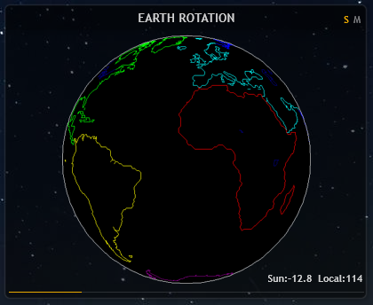
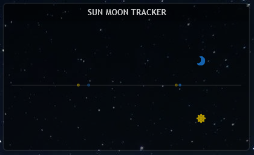
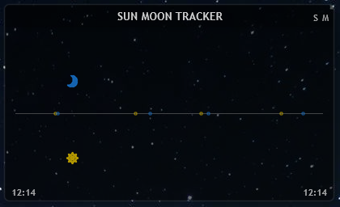
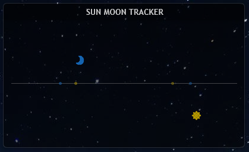

# Rainmeter Sun & Moon Tracker

> 把日月升降时间变成四种可视化视图：**地球光照球、天体轨迹、事件时间轴、视位置模拟**。

**它本质上不依赖 Rainmeter**。核心只有两样东西：一段事件时间序列（日出/日落/月出/月落），和本地经度。剩下的都是几何公式。Rainmeter 只是当前这套渲染壳。本文档先展示效果、给出部署方法，再拆解算法，方便你移植到 Android / iOS / Web / 原生桌面。

---

## 目录

- [效果预览](#效果预览)
- [快速部署（Rainmeter）](#快速部署rainmeter)
- [核心原理（平台无关）](#核心原理平台无关)
- [移植指南](#移植指南)
- [数据格式规范](#数据格式规范)
- [Rainmeter 配置参考](#rainmeter-配置参考)
- [常见问题](#常见问题)
- [已知限制](#已知限制)
- [License](#license)

---

## 效果预览

以下四种视图共用同一份数据，X 轴语义不同，Y 轴共用抛物线模型。

<table>
<tr>
<td width="50%">

<br><sub><b>地球光照球</b> — 太阳/月亮双模式，360 张序列插值还原晨昏线。支持单个或并排显示。</sub>
</td>
<td width="50%">

<br><sub><b>天体轨迹</b> — 一天 24 小时内天体的连续抛物线运动，标出日出/日落/月出/月落。</sub>
</td>
</tr>
<tr>
<td>

<br><sub><b>事件追踪</b> — 以当前时间为中心，滚动展示未来 5 个事件，鼠标悬停显示具体时刻。</sub>
</td>
<td>

<br><sub><b>位置模拟</b> — 以"四事件周期"为时间轴，模拟观察者视角的天体视位置。</sub>
</td>
</tr>
</table>

> 截图放在 `docs/` 目录，按上面文件名命名即可自动显示。新增视图可在表格里继续加一行。

### 四种视图的定位

| 视图 | 回答的问题 | X 轴含义 | 输入 |
|---|---|---|---|
| 地球光照球 | 地球现在被照亮成什么样 | 不需要 X 轴 | 事件对 + 经度 |
| 天体轨迹 | 今天一整天天体怎么动的 | 00:00 → 24:00 | 事件对 |
| 事件追踪 | 接下来的事件在什么时候 | 以当前时间为中心的滚动轴 | 事件列表 |
| 位置模拟 | 天体现在在四事件周期哪一段 | 当前周期进度 | 事件对 |

---

## 快速部署（Rainmeter）

### 前置要求

| 依赖 | 版本 | 用途 |
|---|---|---|
| Windows | 10 / 11 | 运行环境 |
| Rainmeter | 4.5+ | 皮肤引擎 |
| PowerShell | 5.1+ | 数据采集 |
| 和风天气 API Key | [免费版](https://dev.qweather.com/) | 日月数据 |
| 百度地图 AK | [免费版](https://lbsyun.baidu.com/) | IP 定位（可选） |

### 三步启动

```powershell
# 1. 克隆到 Rainmeter Skins 目录
cd "$env:USERPROFILE\Documents\Rainmeter\Skins"
git clone https://github.com/<yourname>/rainmeter-sun-moon-tracker.git

# 2. 配置 API 密钥
copy scripts\WeatherApiKeys.example.json scripts\WeatherApiKeys.json
notepad scripts\WeatherApiKeys.json   # 填入 weatherApiKey 和 baiduAk

# 3. 部署采集脚本并手动跑一次
copy scripts\AstronomicalEvents.ps1 C:\Users\Public\Documents\
powershell -ExecutionPolicy Bypass -File C:\Users\Public\Documents\AstronomicalEvents.ps1
```

确认 `C:\Users\Public\Documents\Rainmeter Data\` 下出现 4 个 txt 后：

1. 双击 `scripts\AstronomicalEvents.xml` 导入任务计划（或管理员运行 `schtasks /Create /XML ...`）
2. 右键 Rainmeter 托盘 → 刷新全部
3. 加载 `Skin\Globe_Combine.ini`（或任意视图）

### 文件放置位置

**采集端**（路径硬编码，移动需同步改 XML 和 INI）：

```
C:\Users\Public\Documents\
├── AstronomicalEvents.ps1
├── WeatherApiKeys.json
└── Rainmeter Data\
    ├── SunEvents.txt
    ├── MoonEvents.txt
    ├── SunTimeStampEvent.txt
    └── MoonTimeStampEvent.txt
```

**展示端**（整体放进 Skins 目录，`@Resources` 必须与 `.ini` 同级）：

```
%USERPROFILE%\Documents\Rainmeter\Skins\rainmeter-sun-moon-tracker\
├── @Resources\
│   ├── Globe\globe_000.png ~ globe_359.png
│   ├── *.lua
│   └── *.png
├── Globe_Combine.ini
├── Trajectory Viewer.ini
├── Event Tracker.ini
└── Position Simulator.ini
```

**图片资源**：`globe_NNN.png` 表示"太阳直射经度 = -NNN°"的地球状态，必须严格按 `000~359` 命名，共 360 张。只用 Tracker 系列可以不下载。

---

## 核心原理（平台无关）

无论你用 Rainmeter、Android、Web 还是原生桌面，只需要理解下面四个概念。

### 输入：事件时间序列

任意来源的日月升落数据，按时间排序后形成一条事件流：

```
1792653840 Moonrise
1792696260 Moonset
1792708620 Sunrise
1792661760 Sunset
...
```

每条事件包含两个字段：`time`（Unix 秒）和 `type`（`Sunrise` / `Sunset` / `Moonrise` / `Moonset`）。

**额外需要一个参数：本地经度** `localLongitude`（东经正、西经负）。它只在地球光照球视图里用得到，其他三个视图不需要。

### 概念 1：时间比例 t

给定当前时间 `now`，找到最近的一对**升起→落下**事件 `(prev, next)`：

```
ratio = (now - prev.time) / (next.time - prev.time)    // 0 → 1

if prev是升起 and next是落下:
    t = ratio               // 白天/可见周期，t ∈ [0, 1]
else:
    t = 1 + ratio           // 夜晚/隐藏周期，t ∈ [1, 2]
```

`t = 0` 是升起瞬间，`t = 1` 是落下瞬间，`t = 2` 是次日升起。

### 概念 2：抛物线 Y 坐标

天体在空中的高度用抛物线近似：

```
可见期（t ∈ [0,1]）:  y = HorizonY - (HorizonY - apex)  * (1 - (2t - 1)²)
隐藏期（t ∈ [1,2]）:  y = HorizonY + (nadir - HorizonY) * (1 - (2(t-1) - 1)²)
```

- `t = 0.5`（正午）时 `y = apex`，抛物线顶点
- `t = 0` 和 `t = 1` 时 `y = HorizonY`，正好在地平线上
- 太阳的 `apex` 根据白昼时长动态调整：白天越长，弧线越高

```
apex = apexMid - (dayDuration - 43200) / maxRate
apex = clamp(apex, apexHigh, apexLow)
```

`43200` 是 12 小时基准，`maxRate` 控制"每多 2 小时抬高多少像素"。月亮可以固定 `apex = apexMid`（简化模型）。

### 概念 3：地球光照图片索引

这是地球光照球视图的核心，只依赖 `t` 和 `localLongitude`。预计算两个锚点：

```
riseIdx = ((-localLongitude - 90) % 360 + 360) % 360    // 日出时的图片索引
setIdx  = (( 90 - localLongitude) % 360 + 360) % 360    // 日落时的图片索引
```

然后按 `t` 插值：

```
if t <= 1:
    idx = lerp360(riseIdx, setIdx, t)         // 白天：日出索引 → 日落索引
else:
    idx = lerp360(setIdx, riseIdx, t - 1)     // 夜晚：日落索引 → 次日日出索引

idx = round(idx) % 360                        // 最终 0 ~ 359
```

`lerp360` 自动处理 360° 循环边界：

```
function lerp360(start, finish, r):
    if start <= finish:
        return start + (finish - start) * r
    else:
        return start + (finish + 360 - start) * r
```

**验证**（`localLongitude = 114`）：`riseIdx = 156`，`setIdx = 336`，正午 `t=0.5` 时 `idx = 246`，直射经度 `-246 mod 360 = 114°`，正好是本地经度。物理上自洽。

### 概念 4：X 轴（三种设计选择）

Y 轴是抛物线，X 轴则取决于你要展示什么：

| 视图 | X 轴公式 | 用途 |
|---|---|---|
| 天体轨迹 | `x = xStart + (now - todayStart) / secondPerPixel` | 一天固定 24 小时 |
| 事件追踪 | `x = xStart + timeOffsetPx`（固定），事件标记按 `(eventTime - axisStart) / secondPerPixel` 映射 | 天体固定在轴中间，事件在周围滚动 |
| 位置模拟 | `x = xStart + (now - cycle.start) / (cycle.end - cycle.start) * length` | 四事件周期进度 |

**四事件周期**：把事件流切成 `[Set₁, Rise₁, Set₂, Rise₂]`，用前两个中点作为 `cycle.start`，后两个中点作为 `cycle.end`。太阳和月亮各自用自己的周期，所以它们的 X 进度不同步——这符合"月亮每天晚升约 50 分钟"的天文事实。

### 输出

四个视图最终都归到少数几个数值：

| 输出 | 类型 | 说明 |
|---|---|---|
| 地球图片索引 | 0~359 整数 | 地球光照球用 |
| 天体坐标 (x, y) | 像素 | 轨迹/位置模拟用 |
| 事件坐标列表 | 像素数组 | 事件追踪用 |
| 状态字符串 | `Rise` / `Fall` / `Day` / `Night` / `Exposed` / `Concealed` | 显示文字 |
| 时间字符串 | `HH:MM` | 事件标记标签 |

---

## 移植指南

### 你真正需要移植什么

| 层 | 是否必须重写 | 说明 |
|---|---|---|
| 数据来源 | **是** | 换成本地天文库或别的 API |
| 时间比例 t | 否 | 公式通用，任何语言 5 行实现 |
| 抛物线 Y | 否 | 通用 |
| 地球图片索引 | 否 | 通用，只需要 360 张图 |
| X 轴设计 | 视需求 | 四种视图选一种或几种 |
| 渲染层 | **是** | 换成本平台的 UI 框架 |

### 数据从哪来

原版用 PowerShell + 和风天气 + 百度 IP，依赖网络和 Windows。移植时**优先考虑纯本地计算**：

**本地库（推荐，无网络依赖）**：

| 语言 | 库 | 提供 |
|---|---|---|
| JavaScript | [`suncalc`](https://github.com/mourner/suncalc) | 太阳/月亮位置、升落时刻 |
| Python | [`astral`](https://github.com/sffjunkie/astral) / [`skyfield`](https://rhodesmill.org/skyfield/) | 日月升落、方位角 |
| Go | [`go-sunrise`](https://github.com/nathan-osman/go-sunrise) | 日出日落 |
| Rust | [`sunrise`](https://crates.io/crates/sunrise) | 日出日落 |
| C/C++ | NOAA SPA / [libnova](https://github.com/JohannesBuchner/libnova) | 完整天文算法 |
| Swift/Kotlin | 调系统 API 或移植 `suncalc` | 参考 JS 版逻辑 |

**免费 API（有网络时可选）**：

- [sunrise-sunset.org](https://sunrise-sunset.org/api) — 日出日落
- [IPGeolocation Astronomy](https://ipgeolocation.io/astronomy-api.html) — 日月升落
- [WeatherAPI.com Astronomy](https://www.weatherapi.com/docs/#astronomy) — 日月升落
- 和风天气（原版）

### 伪代码（任意平台可直接翻译）

```javascript
// 输入：事件列表 events（按时间排序）、当前时间 now、本地经度 localLongitude
// 输出：地球图片索引、天体 Y 坐标、当前状态

function computeAll(events, now, localLongitude) {
  const { prev, next } = findNearestPair(events, now);  // 最近的一对升起→落下

  // 时间比例 t
  const ratio = (now - prev.time) / (next.time - prev.time);
  const isVisible = (prev.type.endsWith('rise') && next.type.endsWith('set'));
  const t = isVisible ? ratio : 1 + ratio;

  // 地球图片索引
  const riseIdx = mod((-localLongitude - 90), 360);
  const setIdx  = mod(( 90 - localLongitude), 360);
  const rawIdx = (t <= 1)
    ? lerp360(riseIdx, setIdx, t)
    : lerp360(setIdx, riseIdx, t - 1);
  const globeIndex = Math.round(rawIdx) % 360;

  // 抛物线 Y
  const horizonY = containerHeight / 2;
  const apex = computeApex(next.time - prev.time);  // 或固定 apexMid
  const nadir = containerHeight - apex;
  const localT = t <= 1 ? t : t - 1;
  const curve = 1 - (2 * localT - 1) ** 2;
  const y = (t <= 1)
    ? horizonY - (horizonY - apex) * curve
    : horizonY + (nadir - horizonY) * curve;

  const state = t <= 1
    ? (t < 0.5 ? 'Rise' : 'Fall')
    : (t < 1.5 ? 'Fall' : 'Rise');

  return { globeIndex, y, state, t };
}

function lerp360(start, finish, r) {
  return start <= finish
    ? start + (finish - start) * r
    : start + (finish + 360 - start) * r;
}

function mod(n, m) {
  return ((n % m) + m) % m;
}
```

这段代码可以直接翻译成 Kotlin、Swift、C#、Rust、Python，逻辑完全一致。

### 各平台实现要点

**Android Widget**（推荐 Jetpack Glance 或 `RemoteViews` + `WorkManager`）：

- 数据：`suncalc` 的 Kotlin/Java 移植，或后台 `WorkManager` 拉 API 写入 `SharedPreferences`
- 渲染：每 15 分钟（系统限制）更新一次；地球图片索引用 `ImageView.setImageResource`，图片放 `res/drawable/globe_000 ~ globe_359`
- 注意：`WorkManager` 最短周期 15 分钟，不足以做秒级动画；如果需要平滑，可以在 Widget 内用 `AnimationDrawable` 循环播放几张关键帧

**Windows 11 Widget Board**（Adaptive Cards，JS 或 C#）：

- 数据：C# 内嵌 `SunCalc.NET` 或本地计算
- 渲染：Adaptive Cards 的图片卡片，或做一个常驻桌面的 WinUI 3 无边框窗口
- 限制：Widget Board 刷新频率较低，更适合"事件追踪"这类静态卡片

**macOS**（Menu Bar App 或 WidgetKit）：

- 数据：Swift 移植 `suncalc`，或调 `CoreLocation` + 本地天文库
- 渲染：`NSStatusItem` + `NSImage` 动态绘制，或 WidgetKit 静态卡片
- 地球图片序列可以打包进 `.bundle`，按索引加载

**Web**（最灵活，适合做演示）：

- 数据：`suncalc` npm 包，`SunCalc.getTimes(date, lat, lon)`
- 渲染：`<canvas>` 或 CSS `background-position` 切换 360 张图；抛物线用 SVG path
- 优点：不需要 360 张图也能演示——可以用 CSS 渐变模拟晨昏线，或只放 24 张整点图

**原生桌面**（Qt / Electron / Tauri / WPF）：

- 数据：宿主语言的天文库
- 渲染：图片序列 + 定时器，和 Rainmeter 思路一致
- Electron/Tauri 可以直接复用 Web 方案

### 最小可移植子集

如果你想快速验证，建议先移植**只有一个视图的最小版本**：

1. 事件追踪（最简单，只需要事件列表 + 一条时间轴）
2. 地球光照球（需要 360 张图，但逻辑最纯）
3. 天体轨迹（需要今日事件查找）
4. 位置模拟（最复杂，需要四事件周期）

---

## 数据格式规范

### 事件文件（每行一条事件）

**格式 A：日期时间**（人读友好）

```
yyyyMMddHHmmEventType
```

| 示例 | 含义 |
|---|---|
| `202610221736Sunset` | 2026-10-22 17:36 日落 |
| `202610230637Sunrise` | 2026-10-23 06:37 日出 |

**格式 B：Unix 时间戳**（程序计算友好）

```
Unix秒EventType
```

| 示例 | 含义 |
|---|---|
| `1792661760Sunset` | 对应 `202610221736Sunset`（本地时区转 UTC） |
| `1792708620Sunrise` | 对应 `202610230637Sunrise` |

`EventType` 必须是 `Sunrise` / `Sunset` / `Moonrise` / `Moonset` 之一。缺失事件可以写 `nullMoonrise`，移植时忽略带 `null` 前缀的行即可。

### 排序与连续性要求

- 事件必须**按时间升序**排列
- 升起和落下应**交替出现**，方便 `findNearestPair` 快速定位
- 至少覆盖前后 2~3 天，否则 `Position Simulator` 的四事件周期会退化

### 时区注意

格式 B 的时间戳基于**生成机器的本地时区**转 UTC。移植到跨时区设备时，要么统一用 UTC，要么在解析时显式转换。

---

## Rainmeter 配置参考

如果你只用 Rainmeter，以下是常用参数速查。

### 采集端

| 文件 | 说明 |
|---|---|
| `scripts/AstronomicalEvents.ps1` | 主脚本，输出 4 个 txt |
| `scripts/AstronomicalEvents.xml` | 任务计划定义，每 4 小时运行 |
| `scripts/WeatherApiKeys.json` | API 密钥（不要提交到 Git） |

任务频率在 XML 中修改：

```xml
<Interval>PT4H</Interval>   <!-- 改为 PT6H / PT12H 减少 API 调用 -->
```

### 展示端

| 参数 | 文件 | 默认值 | 说明 |
|---|---|---|---|
| `LocalLongitude` | 所有 Globe/Tracker INI | `114` | 本地经度 |
| `SecondPerPixel` | Trajectory Viewer | `240` | 360×240 = 86400s = 24h |
| `SecondPerPixel` | Event Tracker | `480` | 360×480 ≈ 2 天 |
| `TimeOffsetInPixels` | Event Tracker | `60` | 当前时间距轴起点像素 |
| `OffsetValue` | Tracker 系列 | `15` | 抛物线顶点浮动幅度 |
| `IconSize` | Tracker 系列 | `21` | 图标尺寸 |
| `UpdateDivider` | `[MeasureLua]` | `60` | Lua 计算间隔（秒） |

### 颜色

```ini
SunColor=255,215,0,255          ; 太阳图标色
MoonColor=30,144,255,255        ; 月亮图标色
HorizonColor=128,128,128,128    ; 地平线色
SunRiseColor=255,215,0,180      ; 日出标记（A=透明度）
MoonSetColor=30,144,255,150     ; 月落标记
```

### 切换太阳/月亮

`Globe.ini` 右上角点击 `S` / `M` 切换，状态保存在 `BodyType.inc`。也可以手动改：

```ini
; BodyType.inc
[Variables]
BodyType=Sun    ; 改为 Moon
```

---

## 常见问题

### Q1：脚本运行后 4 个 txt 没生成

1. 确认 `WeatherApiKeys.json` 在 PS1 同目录，字段名正确
2. 手动运行看控制台：
   ```powershell
   powershell -ExecutionPolicy Bypass -File C:\Users\Public\Documents\AstronomicalEvents.ps1
   ```
3. 检查 `C:\Users\Public\Documents\Rainmeter Data\SunMoonDataError.log` 或 SYSTEM 桌面的 `SunMoonDataError.log`
4. 和风天气控制台确认 API 调用次数未超限

### Q2：加载皮肤后地球空白

- `@Resources\Globe\globe_000.png ~ globe_359.png` 是否齐全
- `.ini` 与 `@Resources` 是否同级
- `ImagePath=#@#Globe\` 末尾反斜杠是否存在

### Q3：地球光照位置不对

`LocalLongitude` 与数据来源城市的经度不一致。东经正、西经负，改成实际值即可。

### Q4：天体轨迹跳出容器

`OffsetValue` 太大，减小到 10 或增大 `SkinHeight`。

### Q5：Event Tracker 多个事件标记叠在一起

`SecondPerPixel` 太大导致事件挤在边缘，减小到 300 左右展开。

### Q6：任务计划运行了但文件没更新

- 任务计划程序 → `AstronomicalEvents` → 历史记录，看返回码
- SYSTEM 账户的桌面路径可能不可写，把 PS1 错误日志路径改为公共目录
- 检查 `StopMultipleInstances` 策略

---

## 已知限制

- **`LocalLongitude` 不会自动同步**：PS1 定位到的经度不写回 INI，需手动保持一致
- **10 位时间戳假设**：Lua 中 `line:sub(1, 10)` 在 2038 年后会失效
- **月亮模型简化**：顶点固定，未考虑月相和赤纬
- **四事件周期依赖数据密度**：事件不足时 `Position Simulator` 会退化
- **SYSTEM 账户错误日志**：`[Environment]::GetFolderPath("Desktop")` 在 SYSTEM 下可能不可写

---

## License

MIT License，详见 [LICENSE](LICENSE)。
